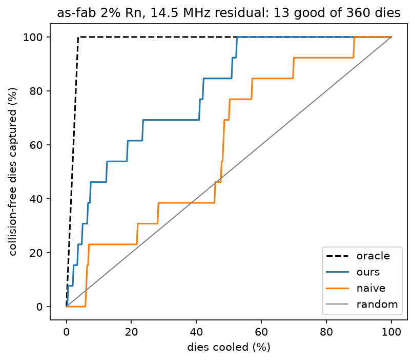

# transmon-yield

[](https://github.com/divyeshidhate/transmon-yield/actions/workflows/tests.yml)

**Ranking superconducting-qubit dies before cooldown from room-temperature junction data: a reproduction of published results and a simulation study.**

Every junction on a wafer can be probed at room temperature on an automated wafer prober; cooling a chip to millikelvin
temperatures and characterising it takes far longer. This repo asks:
*using only room-temperature resistance and a few cooled calibration dies, which dies should you cool first to find
collision-free chips, and how accurate must the prediction be for that to help?*



*Cool dies in ranked order: what fraction of the truly collision-free dies have you found? One synthetic wafer
(360 uncooled dies, 13 collision-free) with ~2% Rn spread and a 14.5 MHz per-qubit prediction residual. Notebook 04.*

## Key results (simulation, synthetic data)

All results: heavy-hex d = 3 chip (23 qubits, 5.00 / 5.07 / 5.14 GHz), one chip per 10 × 7 mm die, 370 dies per 200 mm
wafer, 10 calibration dies, averaged over 10 synthetic wafers. "Residual" = the within-die, per-qubit frequency error that
room-temperature data cannot explain.

- **~27 vs ~128 cooldowns to find 5 collision-free chips** (ours vs random; naive ordering by |Rn − target|: ~73),
  for an untrimmed wafer with ~2% Rn spread and a 14.5 MHz residual. Only ~4% of dies are collision-free here.
- **After trimming to 0.5% Rn spread, ranking barely helps**: ~49% of dies are collision-free at a 14.5 MHz residual,
  but the ranking gain is only 0.08 (0 = random, 1 = perfect). It needs a residual of ≲ 5–10 MHz (gain 0.44 at 5 MHz,
  0.17 at 10 MHz). Trimming removes the within-die variation that ranking relies on.
- **Only within-die, per-qubit error matters for picking dies.** A shift in effective T_c from 0.71 to 0.68 K biases
  absolute predictions by +115 MHz but leaves the ranking unchanged (gain 0.61 vs 0.62). Recalibrating on 3 cooled
  dies removes the bias (−0.5 ± 1.7 MHz).
- **A 1.6% residual (~81 MHz), if entirely per-qubit, leaves no collision-free heavy-hex chips at all** (both Rn
  presets). What matters is how much of the error is shared by the whole die. With 10 cooled dies the calibration
  recovers that split (10.6 / 11.0 MHz estimated vs 10.3 / 10.3 MHz true).
- **Calibration is cheap**: effective T_c is fitted to ±0.0007 K from 2 cooled dies, and the ranking gain is flat
  (0.60–0.64) from 2 to 20 calibration dies.

## What we reproduced

**Room-temperature resistance → qubit frequency** (Eq. 1 of Mayer, Weber et al. 2025, T_c = 0.71 K, C_q = 86 fF): notebook 01

| | Paper | This repo |
|---|---|---|
| f01 at Rn = 7.1 kΩ | design 4.42 GHz | 4.397 GHz |
| Rn needed for 4.42 GHz | ≈ 7.1 kΩ | 7.03 kΩ |
| f01 error if the bulk-Al T_c (1.2 K) is used instead | – | +31.5% |

**Collision-free yield, Hertzberg et al. 2021, Table 2** (σ_f = 14 MHz; lattices transcribed from their Supplementary Figs 1–9): notebook 03

| Lattice (qubits) | Yield, paper | Yield, ours | Mean collisions, paper | Mean collisions, ours |
|---|---|---|---|---|
| Heavy-hex d=3 / 5 / 7 (23 / 65 / 127) | 70 / 33 / 8% | 70.0 / 29.7 / 10.5% | 0.4 / 1.2 / 2.7 | 0.38 / 1.19 / 2.35 |
| Heavy-square d=3 / 5 / 7 (25 / 73 / 145) | 67 / 27 / 6% | 66.6 / 26.9 / 6.6% | 0.4 / 1.5 / 3.5 | 0.45 / 1.46 / 3.00 |
| Square d=3 / 5 / 7 (17 / 49 / 97) | 6 / <0.1 / <0.1% | 5.6 / 0.0 / 0.0% | 3 / 10 / 23 | 2.29 / 8.10 / 19.35 |

Where we differ: our square lattices show ~20% fewer mean collisions than the paper. We could not pin down why. The exact
counting rules and the frequency-step sweep range are not published.

## What is ours vs assumed

| Item | Value | Status |
|---|---|---|
| Rn variance split: wafer trend / die offset / junction | 50 / 25 / 25% | Assumption (Kreikebaum et al.'s data suggest the local share is ~20–45%) |
| Residual split: per-qubit / die-shared | 100 / 0% (sensitivity run at 50 / 50%) | Assumption |
| Capacitance C_q in the ranking study | 68.1 fF | Derived: chosen so exact anharmonicity = −330 MHz (Hertzberg et al.) |
| Chip frequencies | 5.00 / 5.07 / 5.14 GHz, fixed | Example from Hertzberg et al.; not optimised |
| Edge exclusion | 4 mm | Assumption, chosen to land near Lang et al.'s ~375 dies |
| Rn probe noise | 0.1% | Hertzberg et al. ("better than 0.1%") |
| Rn spread presets | 2% / 0.5% | Križan et al. 2026 (citing their ref. [9]) / Wang et al. 2026 |
| Residual presets | 14.5 MHz / 1.6% | Hertzberg et al. 2021 / Mayer, Weber et al. 2025 |
| Frequency-step sweep (notebook 03) | 30–150 MHz | Our choice (range not published) |

Combining the papers: the ranking study uses an IBM-style chip and collision rules with Fraunhofer's
room-temperature → frequency model. It is not a model of any one fab's chip.

## Limitations

- **Synthetic data only.** Wafers are generated from published statistics; nothing here is validated on real fab data.
- **Simplified frequency plan.** One fixed 3-frequency pattern; real chips also have resonators, couplers and other constraints.
- **Results depend on assumptions**, especially the variance split, which sets how much within-die variation the probe can see.
- **Simple models**: Eq. 1 with a single fitted T_c; Gaussian residuals; Table 1 collision windows taken as hard cut-offs.

## How to run

Tested on Python 3.12 and 3.13.

```bash
pip install -e ".[all]"
```

Run the tests and execute all four notebooks:

| | macOS / Linux | Any OS (including Windows) |
|---|---|---|
| Tests + notebooks | `make all` | `python run_all.py` |
| Tests only | `make test` | `python -m pytest` |
| Also save notebook outputs and regenerate `docs/capture_curve.png` | `make notebooks` | `python run_all.py --inplace` |

| Notebook | Content |
|---|---|
| `01_rt_to_frequency` | Ambegaokar–Baratoff + transmon chain; Fraunhofer design point; exact diagonalisation |
| `02_synthetic_wafer` | 200 mm synthetic wafer; predicted vs measured f01 |
| `03_collision_yield` | Reproduction of Hertzberg et al. 2021; bridge from wafer spread to yield |
| `04_die_ranking` | Die ranking, residual sweep, calibration, drift (expected vs actual for each experiment) |

## References

- T. Mayer, J. Weber et al., *CMOS-Compatible, Wafer-Scale Processed Superconducting Qubits Exceeding Energy Relaxation Times of 200 µs*, [arXiv:2505.08424](https://arxiv.org/abs/2505.08424) (2025).
- S. J. K. Lang et al., *CMOS-compatible processing and room-temperature characterization on wafer-level for scalable quantum computing*, Phys. Rev. Applied 24, 054052 (2025), [doi:10.1103/42nj-fjg8](https://journals.aps.org/prapplied/abstract/10.1103/42nj-fjg8), [arXiv:2504.18173](https://arxiv.org/abs/2504.18173).
- J. B. Hertzberg et al., *Laser-annealing Josephson junctions for yielding scaled-up superconducting quantum processors*, npj Quantum Information 7, 129 (2021), [doi:10.1038/s41534-021-00464-5](https://doi.org/10.1038/s41534-021-00464-5), [arXiv:2009.00781](https://arxiv.org/abs/2009.00781); and Hertzberg et al. 2021, Supplementary Information.
- C. Križan et al., *Electrical post-fabrication tuning of aluminum Josephson junctions at room temperature*, Materials for Quantum Technology (2026), [doi:10.1088/2633-4356/ae7fe1](https://iopscience.iop.org/article/10.1088/2633-4356/ae7fe1/meta), [arXiv:2602.20002](https://arxiv.org/abs/2602.20002).
- X. Wang et al., *Scaling Alternating-Bias-Assisted Annealing for Precision Transmon Frequency Targeting on Superconducting Quantum Processors*, [arXiv:2608.27789](https://arxiv.org/abs/2608.27789) (2026).
- J. M. Kreikebaum et al., *Improving wafer-scale Josephson junction resistance variation in superconducting quantum coherent circuits*, Supercond. Sci. Technol. 33, 06LT02 (2020), [doi:10.1088/1361-6668/ab8617](https://doi.org/10.1088/1361-6668/ab8617), [arXiv:1909.09165](https://arxiv.org/abs/1909.09165), including its supplementary material.
- J. Koch et al., *Charge-insensitive qubit design derived from the Cooper pair box*, Phys. Rev. A 76, 042319 (2007).
- V. Ambegaokar and A. Baratoff, Phys. Rev. Lett. 10 (1963) (critical current from normal-state resistance).
- [scqubits](https://scqubits.readthedocs.io) (used only in tests, as an independent check of the transmon spectrum).

## License

MIT (see `LICENSE`).

---

Have real wafer data (RT resistance + cryo frequencies)? I'd like to test this on it.
Email: divyeshidhate2709@gmail.com · LinkedIn: https://www.linkedin.com/in/divyesh-idhate-bb1170218
